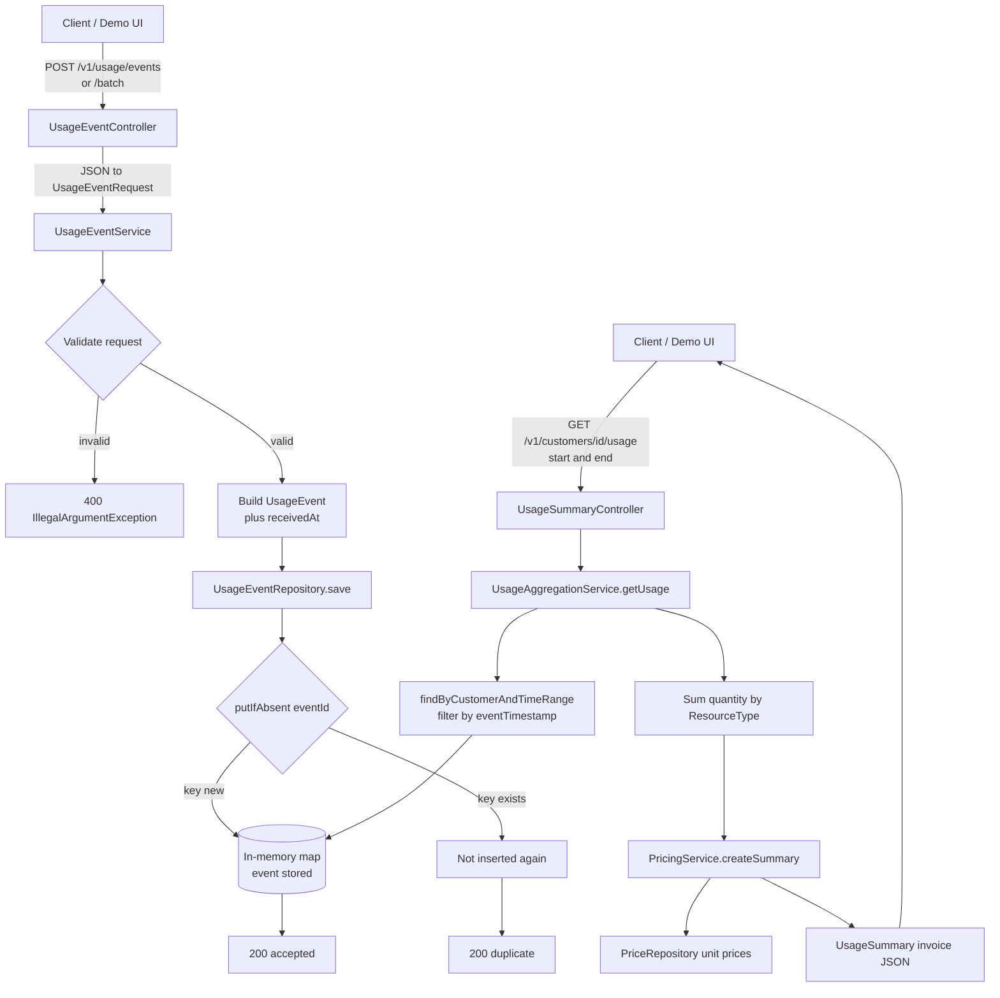
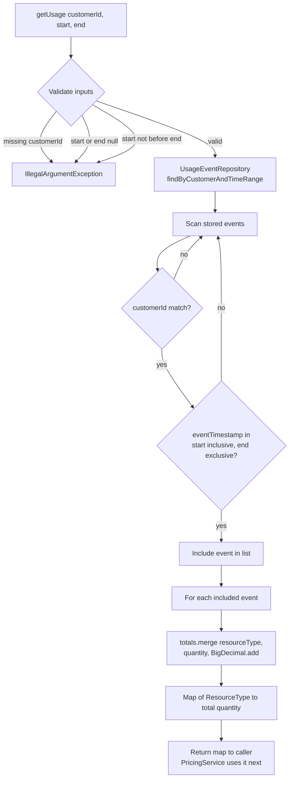

# Usage Billing Service

Plain Java service that ingests usage events, aggregates them by resource type, and returns a priced customer summary (invoice JSON).

## Architecture

### End-to-end flow (ingest → storage → aggregation)

Idempotency is enforced in storage with `putIfAbsent(eventId)`.



### UsageAggregationService flow



## Setup

- Requires **Java 17+** and **Maven**
- Build and test:
  - `mvn -B clean test`
- Run locally:
  - `mvn -B -q dependency:copy-dependencies -DoutputDirectory=target/deps`
  - `mvn -B -q package -DskipTests`
  - `java -cp "target/classes:target/deps/*" usagebilling.Main`
- Service listens on **port 8080**
- Demo UI: `http://localhost:8080/`
- Optional Docker:
  - `docker build -t usage-billing-service .`
  - `docker run -p 8080:8080 usage-billing-service`

## APIs

- `POST /v1/usage/events` — ingest one event
- `POST /v1/usage/events/batch` — ingest many events
- `GET /v1/usage/events` — list all stored events (debug)
- `DELETE /v1/usage/events` — clear all stored events (debug)
- `GET /v1/customers/{customerId}/usage?start=...&end=...` — usage + priced summary
  - `start` / `end` must be ISO-8601 UTC, e.g. `2026-09-23T00:00:00Z`
  - window is `[start, end)` (start inclusive, end exclusive)

## Event schema

Single event body:

```json
{
  "eventId": "E1",
  "customerId": "C1",
  "resourceType": "DATABASE",
  "quantity": 10,
  "eventTimestamp": "2026-09-23T10:00:00Z"
}
```

- `eventId` — caller-supplied id; used for **idempotency**
- `customerId` — who used the resource
- `resourceType` — one of: `DATABASE`, `LOAD_BALANCER`, `COMPUTE`, `STORAGE`
- `quantity` — amount used; must be **>= 0**
- `eventTimestamp` — when usage happened (UTC); cannot be more than **5 minutes** in the future

Batch body:

```json
{
  "events": [ /* array of events as above */ ]
}
```

Stored events also include:

- `receivedAt` — server receive time (audit only; not used for billing windows)

## Price table configuration

- Prices live in `InMemoryPriceRepository` (hard-coded in code today)
- Currency: **USD**
- Current unit prices:
  - `DATABASE` → `0.05`
  - `LOAD_BALANCER` → `0.02`
  - `COMPUTE` → `0.03`
  - `STORAGE` → `0.01`
- Invoice line cost = `quantity × unitPrice` (rounded to 2 decimals)
- To change prices: edit `InMemoryPriceRepository` and restart the app

## Known limitations (aggregation approach)

- Storage is **in-memory only** — data is lost on restart / redeploy
- Aggregation is a **full scan** of stored events filtered by customer/window — fine for **small scale** / demos, not for large scale
- For **large scale**, move off in-memory full scans, for example:
  - store events in a database with indexes on `(customer_id, event_timestamp)`
  - pre-aggregate (hourly/daily rollups) so invoice queries read summaries, not every raw event
  - optionally use a stream/queue (Kafka, etc.) to ingest and update aggregates asynchronously
  - shard or partition by customer if volume is very high
- Billing window uses **`eventTimestamp` only** — late-arriving events still count if their timestamp falls in range
- `receivedAt` is **not** used for aggregation or pricing
- No historical price versions — one flat price table for all time
- No tax, discounts, tiers, or minimum charges
- Unknown / unpriced resource types are **skipped** in the invoice
- Duplicate `eventId` is not an error (HTTP 200 `duplicate`) but is not double-counted
- Not a durable ledger — not suitable as a source of truth for production billing without a real database
- Detailed exception handling is minimal — no rich error codes, structured error catalog, or extensive error comments; failures usually return a simple `{"message":"..."}` with HTTP 400/500

## Test coverage gaps

Covered today (service-level only): idempotency, negative quantity, missing eventId, future timestamp skew, out-of-order aggregation, grouping by resource type, basic pricing total.

Missed / not covered yet:

- Batch ingest (`ingestBatch`) — happy path and empty/invalid batch
- Other request validation — missing customerId, resourceType, quantity, eventTimestamp; blank strings; null request body
- Timestamp **within** the allowed 5-minute future skew (should be accepted)
- Aggregation edge cases — events outside the time window, wrong customer, `start >= end`
- Pricing edge cases — unknown resource type skipped, rounding edge cases
- HTTP / controller tests — status codes, duplicate returns 200, query param decoding, clear/list endpoints
- Demo page / UI behavior
- End-to-end path in one test — ingest → aggregate → priced summary
- Concurrent duplicate ingest under load
